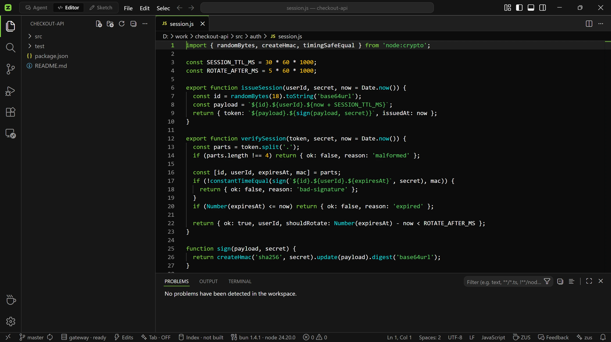
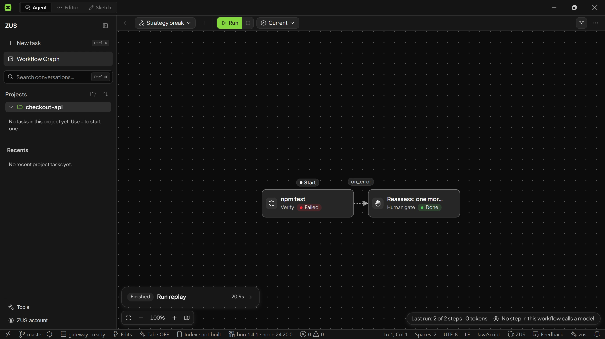
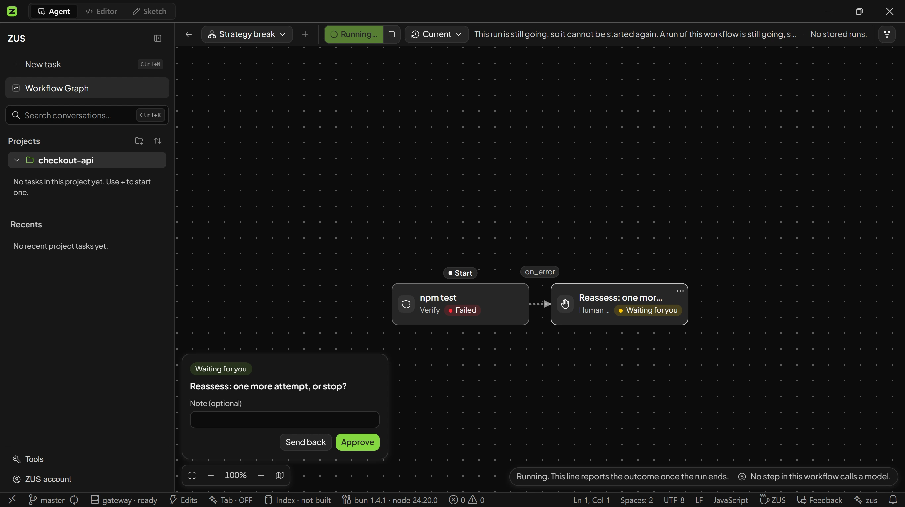
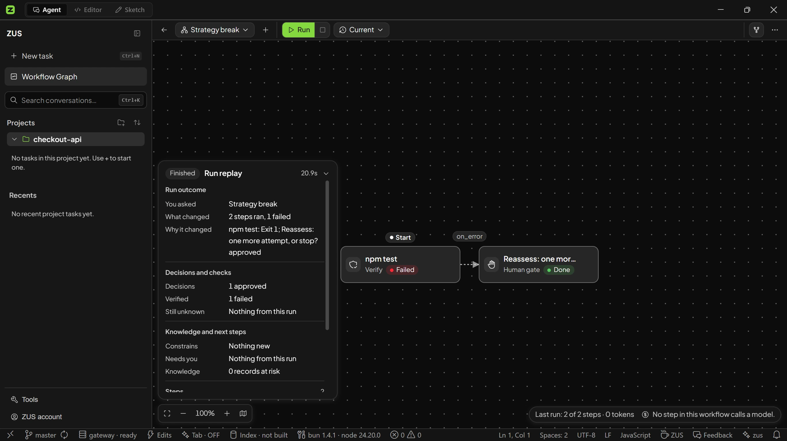
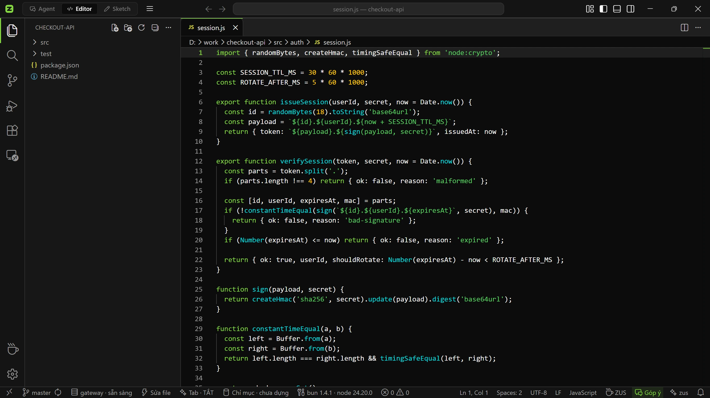
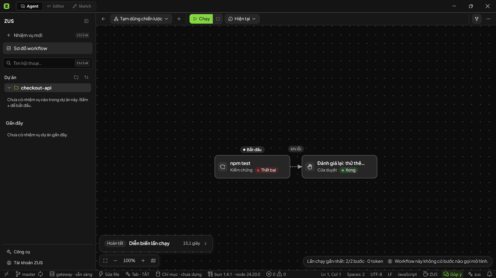
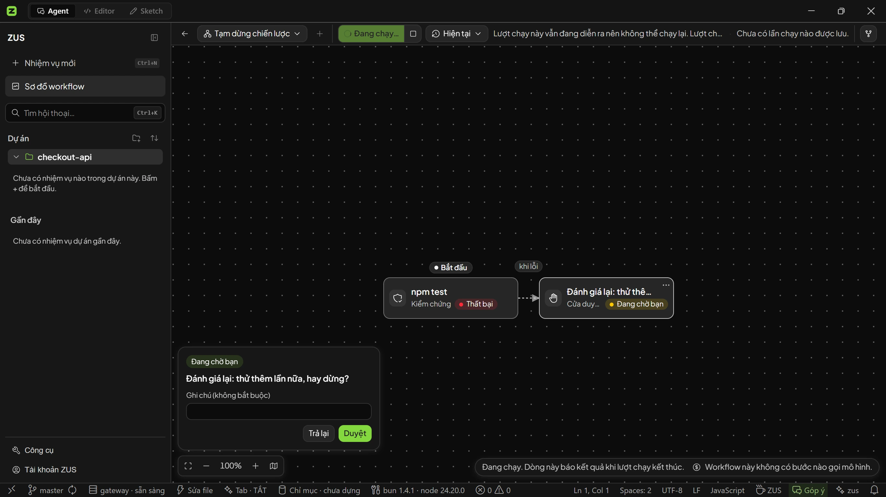

<div align="center">


# ZUS

**A fast, lightweight AI IDE with an autonomous agent and verifiable test execution.**

*Môi trường phát triển AI gọn nhẹ với agent tự động và kiểm chứng lệnh thực tế.*

[](https://github.com/8syncdev/zus-releases/releases/latest)
[](https://github.com/8syncdev/zus-releases/releases)
[](https://discord.gg/Pparnq7bV7)


[English](#english) · [Tiếng Việt](#tiếng-việt) · [Discord Community](https://discord.gg/Pparnq7bV7)

<br>



</div>

---

## English

ZUS is an AI-native desktop IDE built with Tauri 2 and Rust. It combines the VS Code workbench with a local-first autonomous agent in a 22.3 MB installer.

Most AI development environments package a Chromium browser, send code to remote indexing servers, and display code changes inside chat threads. ZUS uses a different architecture:

1. The desktop app pairs the operating system's native WebView with a Rust core, avoiding the memory overhead of bundled Chromium binaries.
2. Semantic code search and vector embeddings run locally on your machine.
3. Agent tasks run through a structured execution graph with operating system exit codes, Git checkpoints, and human approval gates.

### Core capabilities

#### Architecture and performance
- **22.3 MB installer:** Tauri 2 uses the operating system's native WebView and a Rust backend. The Windows installer is 22.3 MB, compared to approximately 184 MB for Cursor and 199 MB for VS Code.
- **Low resource consumption:** The application starts in under 400 ms on modern hardware. Idle memory consumption stays under 120 MB, keeping system resources available for build tools and test suites.

#### Execution engines
- **Interactive chat with Live Plan (`zus://agent`):** Conversational agent interface with a real-time task ledger tracking pending, running, completed, and blocked states.
- **Workflow DAG canvas (`zus://workflow`):** Visual editor for designing and running multi-step pipelines (investigate, fix, verify, gate, review). Features loop detection and error branch tracing.
- **Autonomous goal runner (`zus://goal`):** Multi-round execution loop that works across multiple files, verifying test results after each step.

#### Verification and provenance
- **Deterministic exit codes:** Test, build, and lint steps execute in terminal processes and check actual process exit codes. Steps show green only when the process exits with status code 0.
- **Execution provenance:** Every tool execution and verification run mints a provenance ID (`step-N-exec-M`), capturing the process ID, start and completion timestamps, working directory, and exit code.
- **Raw log copy:** Failed steps include a one-click action to copy raw terminal output directly to your clipboard.

#### Safety and approval gates
- **Three autonomy levels:** Ask first (confirm every action), Edits (edit files automatically, confirm deletions and terminal commands), and Autopilot (unattended execution within workspace limits).
- **Human approval gates:** Execution halts before sensitive operations such as file deletions, arbitrary shell scripts, or git commits. You can approve, reject, or return the step with notes.
- **Anti-blind-retry guard:** When a command fails with unobserved external side effects (`effectUnknown`), the engine stops instead of repeating the command.
- **Git checkpoints:** Automated git snapshots before file modifications. Rollback checks the working tree first and refuses to overwrite newer manual edits.

#### Privacy and local transparency
- **On-device semantic search:** Vector embeddings and code graph indexes are generated and stored locally. Source files are not uploaded to an external vector database.
- **Network egress ledger (`zus://network-ledger`):** An internal ledger recording outbound network requests from the IDE, including destination host, byte counts, and subsystem. Exports to CSV or JSON.
- **Context inspector:** Displays the exact payload, system prompts, attachments, and token counts sent to the model for each turn.
- **Token budget ceiling:** Per-session token caps that stop execution immediately when reached.
- **Workspace file jail:** File system writes are restricted to the active project directory with per-command path allowlists.

#### Workbench and extensibility
- **Unified diff review:** View unified and side-by-side diffs across all modified files before accepting changes.
- **Context targeting:** Target `@file`, `@folder`, `@symbol`, and `#git` directly in prompts to control token consumption.
- **Rules support:** Reads project conventions from `.cursorrules`, `CLAUDE.md`, and `.zus/rules`.
- **Model Context Protocol (MCP):** Connect external tools, databases, and APIs through standard `mcp.json` definitions.
- **VS Code compatibility:** Monaco editor, integrated PTY terminal, visual Git graph, project search, Open VSX extension support, and 14 editor themes.

<div align="center">

</div>

<br>

<div align="center">
 
</div>

### Installation

#### Windows

Install via Winget:

```powershell
winget install 8syncdev.ZUS
```

Or via Scoop:

```powershell
scoop bucket add zus https://github.com/8syncdev/scoop-zus
scoop install zus
```

Or download `ZUS_x.y.z_x64-setup.exe` directly from the [latest release](https://github.com/8syncdev/zus-releases/releases/latest).

> **SmartScreen notice:** Direct installer downloads do not yet carry an enterprise certificate. Installing via winget or scoop avoids this prompt. For a manually downloaded executable, verify the minisign signature below, then click **More info -> Run anyway**.

#### macOS (Apple Silicon)

Download `ZUS_x.y.z_aarch64.dmg`. On first launch, right-click the application and select **Open -> Open**, or run:

```bash
xattr -dr com.apple.quarantine /Applications/ZUS.app
```

#### Linux

| Distribution | Command |
|---|---|
| Debian / Ubuntu | `sudo apt install ./ZUS_x.y.z_amd64.deb` |
| Fedora / RHEL | `sudo dnf install ./ZUS-x.y.z-1.x86_64.rpm` |
| Any | `chmod +x ZUS_x.y.z_amd64.AppImage && ./ZUS_x.y.z_amd64.AppImage` |

### Download verification

Every release includes a **minisign signature** (`.sig`) generated with the ZUS updater key `1c2f579d3d50beda`.
The application verifies these signatures against its compiled-in public key before installing any update. Any modified binary is rejected.

Use `SHA256SUMS.txt` to verify download integrity:

```bash
# Verify checksums:
sha256sum -c --ignore-missing SHA256SUMS.txt

# Verify SHA256SUMS.txt authenticity via minisign:
minisign -Vm SHA256SUMS.txt -x SHA256SUMS.txt.sig \
  -P RWQcL1edPVC+2lpQSHFmsRXjz8wl4PI2PNpttRs7zZ7lqAvtNZU18tho
```

To verify an individual download manually (for example, `ZUS_x.y.z_amd64.AppImage` and its signature):

```bash
base64 -d ZUS_x.y.z_amd64.AppImage.sig > artifact.minisig
minisign -Vm ZUS_x.y.z_amd64.AppImage -x artifact.minisig \
  -P RWQcL1edPVC+2lpQSHFmsRXjz8wl4PI2PNpttRs7zZ7lqAvtNZU18tho
```

### Automatic updates

On launch, ZUS queries `latest.json` from the latest release and applies updates in place. The app cryptographically verifies every update binary before installation.

### Community

Join the official ZUS Discord community to ask questions, share workflows, or report issues: **[discord.gg/Pparnq7bV7](https://discord.gg/Pparnq7bV7)**.

---

## Tiếng Việt

ZUS là môi trường phát triển tích hợp (IDE) chuyên dụng cho AI, xây dựng trên nền tảng Tauri 2 và Rust. Ứng dụng kết hợp đầy đủ không gian làm việc của VS Code với agent tự động cục bộ, đóng gói trong bộ cài 22.3 MB.

Phần lớn các IDE AI hiện nay phân phối kèm một bản Chromium hoàn chỉnh, tải mã nguồn lên máy chủ để lập chỉ mục và hiển thị kết quả qua các đoạn chat dài. ZUS chọn hướng kiến trúc khác:

1. Giao diện sử dụng WebView của hệ điều hành kết hợp backend bằng Rust, loại bỏ chi phí tài nguyên của Chromium đóng gói sẵn.
2. Lập chỉ mục ngữ nghĩa và vector embedding chạy trực tiếp trên phần cứng của bạn.
3. Mọi thao tác của agent được điều phối qua đồ thị thực thi có cấu trúc, kiểm tra mã thoát (exit code) thực tế từ terminal, tạo checkpoint bằng Git và dừng lại tại các cửa duyệt có người kiểm tra.

### Tính năng cốt lõi

#### Kiến trúc và hiệu năng
- **Bộ cài 22.3 MB:** Kiến trúc Tauri 2 sử dụng WebView hệ điều hành và lõi Rust. Bộ cài Windows có dung lượng 22.3 MB, so với khoảng 184 MB của Cursor và 199 MB của VS Code.
- **Khởi động nhanh và tiết kiệm tài nguyên:** Thời gian mở ứng dụng dưới 400 ms trên phần cứng phổ thông. Bộ nhớ RAM ở trạng thái chờ dưới 120 MB, nhường tài nguyên cho trình biên dịch và công cụ kiểm thử cục bộ.

#### Cơ chế thực thi của agent
- **Chat tương tác với Live Plan (`zus://agent`):** Giao diện trò chuyện trực tiếp với agent có danh sách công việc hiển thị trạng thái thực tế: đang chờ, đang chạy, hoàn tất hoặc bị chặn.
- **Đồ thị workflow trực quan (`zus://workflow`):** Trình soạn thảo DAG để thiết kế và chạy chuỗi tác vụ nhiều bước (khảo sát, sửa mã nguồn, kiểm chứng, cửa duyệt, rà soát). Tích hợp cơ chế phát hiện vòng lặp và truy vết nhánh lỗi.
- **Vòng lặp tự động (`zus://goal`):** Tự động giải quyết bài toán phức tạp trên nhiều file, kiểm chứng kết quả sau mỗi vòng lặp.

#### Kiểm chứng tất định và nguồn gốc thực thi
- **Mã thoát (exit code) thực tế:** Các bước build, test và lint chạy trực tiếp trong terminal và kiểm tra mã thoát của tiến trình. Bước thực thi chỉ báo trạng thái đạt khi câu lệnh trả về mã 0.
- **Nguồn gốc thực thi (Execution Provenance):** Mỗi lần gọi công cụ hay kiểm chứng đều được cấp một định danh (`step-N-exec-M`), ghi nhận process ID, mốc thời gian, thư mục làm việc và mã thoát.
- **Sao chép log lỗi trực tiếp:** Hộp thông báo lỗi của bước hỏng tích hợp nút sao chép toàn bộ nội dung terminal vào clipboard để phân tích.

#### Kiểm soát an toàn và can thiệp thủ công
- **Ba mức tự chủ:** Hỏi trước mọi thao tác (Ask first), Tự sửa file và hỏi khi xóa hoặc chạy lệnh (Edits), Tự động hoàn toàn trong thư mục dự án (Autopilot).
- **Cửa duyệt (Human Gate):** Tạm dừng tiến trình trước các thao tác nhạy cảm như xóa tệp tin, chạy lệnh shell hoặc commit git. Người dùng có thể chấp thuận, từ chối hoặc gửi lại phản hồi kèm ghi chú.
- **Chặn thử lại mù quáng (Anti-Blind-Retry):** Khi một thao tác gặp lỗi mà chưa xác định được tác động ngoại vi (`effectUnknown`), hệ thống sẽ dừng lại thay vì tự động chạy lại liên tục.
- **Checkpoint qua Git:** Tự động lưu snapshot trạng thái Git trước khi can thiệp sâu. Tính năng hoàn tác sẽ kiểm tra cây thư mục và từ chối ghi đè nếu bạn đã chỉnh sửa file sau thời điểm checkpoint.

#### Quyền riêng tư và minh bạch dữ liệu
- **Tìm kiếm ngữ nghĩa tại máy:** Vector embedding và chỉ mục đồ thị mã nguồn được lưu trữ trực tiếp trên ổ cứng. Mã nguồn của bạn không bị tải lên cơ sở dữ liệu vector bên ngoài.
- **Sổ cái xuất mạng (`zus://network-ledger`):** Bảng kiểm toán nội bộ ghi lại từng request HTTP phát ra từ IDE, bao gồm địa chỉ máy chủ, lượng byte truyền nhận và hệ thống con thực hiện. Hỗ trợ xuất dữ liệu ra file CSV hoặc JSON.
- **Thanh tra ngữ cảnh (Context Inspector):** Xem chi tiết nội dung prompt, system prompt, tệp đính kèm và số lượng token gửi tới mô hình trước mỗi lượt gọi.
- **Trần chi phí token:** Cài đặt giới hạn token tối đa cho từng phiên làm việc để tránh vượt hạn mức quota ngoài ý muốn.
- **Khoanh vùng thư mục dự án (Workspace Jail):** Mọi thao tác ghi tệp tin bị giới hạn chặt chẽ trong thư mục gốc của dự án với danh sách lệnh được cấp phép.

#### Trải nghiệm lập trình và khả năng mở rộng
- **Rà soát diff hợp nhất:** Xem diff trực quan từng file hoặc toàn bộ các thay đổi trước khi xác nhận gộp mã nguồn.
- **Bộ chọn ngữ cảnh chính xác:** Nạp ngữ cảnh tập trung với cú pháp `@file`, `@folder`, `@symbol`, và `#git`.
- **Hỗ trợ quy ước dự án:** Tự động đọc và tuân thủ cấu hình từ `.cursorrules`, `CLAUDE.md`, và `.zus/rules`.
- **Giao thức MCP (Model Context Protocol):** Mở rộng công cụ qua tệp cấu hình `mcp.json` tiêu chuẩn.
- **Tương thích VS Code:** Trình soạn thảo Monaco, terminal PTY tích hợp, đồ thị Git, tìm kiếm toàn dự án, chợ tiện ích Open VSX và 14 giao diện màu tùy chỉnh.

<div align="center">

</div>

<br>

<div align="center">
 
</div>

### Cài đặt

#### Windows

Cài qua Winget:

```powershell
winget install 8syncdev.ZUS
```

Hoặc qua Scoop:

```powershell
scoop bucket add zus https://github.com/8syncdev/scoop-zus
scoop install zus
```

Hoặc tải trực tiếp file `ZUS_x.y.z_x64-setup.exe` từ [bản phát hành mới nhất](https://github.com/8syncdev/zus-releases/releases/latest).

> **Lưu ý về SmartScreen:** Bản cài tải tay chưa gắn chứng chỉ doanh nghiệp nên Windows sẽ hỏi lại. Cài qua winget hoặc scoop sẽ bỏ qua bước này. Nếu tải file `.exe` thủ công, bạn có thể đối chiếu chữ ký minisign bên dưới, sau đó bấm **More info -> Run anyway**.

#### macOS (Apple Silicon)

Tải file `ZUS_x.y.z_aarch64.dmg` từ release. Trong lần đầu mở, click chuột phải vào app chọn **Open -> Open**, hoặc chạy lệnh:

```bash
xattr -dr com.apple.quarantine /Applications/ZUS.app
```

#### Linux

| Bản phân phối | Lệnh cài đặt |
|---|---|
| Debian / Ubuntu | `sudo apt install ./ZUS_x.y.z_amd64.deb` |
| Fedora / RHEL | `sudo dnf install ./ZUS-x.y.z-1.x86_64.rpm` |
| Bất kỳ | `chmod +x ZUS_x.y.z_amd64.AppImage && ./ZUS_x.y.z_amd64.AppImage` |

### Xác thực bản tải về

Mỗi bản phát hành đi kèm chữ ký số **minisign** (`.sig`) tạo bởi khóa updater của ZUS: `1c2f579d3d50beda`.
Ứng dụng tự động đối chiếu chữ ký này với public key tích hợp bên trong trước khi cài đặt hoặc cập nhật. Mọi file bị can thiệp sẽ bị từ chối.

Kiểm tra tính toàn vẹn qua file `SHA256SUMS.txt`:

```bash
# Kiểm tra mã băm SHA256:
sha256sum -c --ignore-missing SHA256SUMS.txt

# Xác thực tính xác thực của file SHA256SUMS qua minisign:
minisign -Vm SHA256SUMS.txt -x SHA256SUMS.txt.sig \
  -P RWQcL1edPVC+2lpQSHFmsRXjz8wl4PI2PNpttRs7zZ7lqAvtNZU18tho
```

Xác thực thủ công một file cài đặt cụ thể (ví dụ `ZUS_x.y.z_amd64.AppImage` và file `.sig` đi kèm):

```bash
base64 -d ZUS_x.y.z_amd64.AppImage.sig > artifact.minisig
minisign -Vm ZUS_x.y.z_amd64.AppImage -x artifact.minisig \
  -P RWQcL1edPVC+2lpQSHFmsRXjz8wl4PI2PNpttRs7zZ7lqAvtNZU18tho
```

### Tự động cập nhật

Mỗi khi khởi động, ZUS kiểm tra file `latest.json` ở bản release mới nhất và cập nhật tại chỗ. Ứng dụng kiểm tra chữ ký số của mọi bản cập nhật trước khi cài đặt.

### Tham gia cộng đồng

Gia nhập Discord chính thức của ZUS để trao đổi về workflow, đóng góp ý kiến hoặc báo lỗi: **[discord.gg/Pparnq7bV7](https://discord.gg/Pparnq7bV7)**.

---

<div align="center">


**8 Sync Dev** · [8syncdev.com](https://8syncdev.com) · [Discord](https://discord.gg/Pparnq7bV7) · atus@8syncdev.com

*Sync is a loop: two systems, one link.*

</div>
