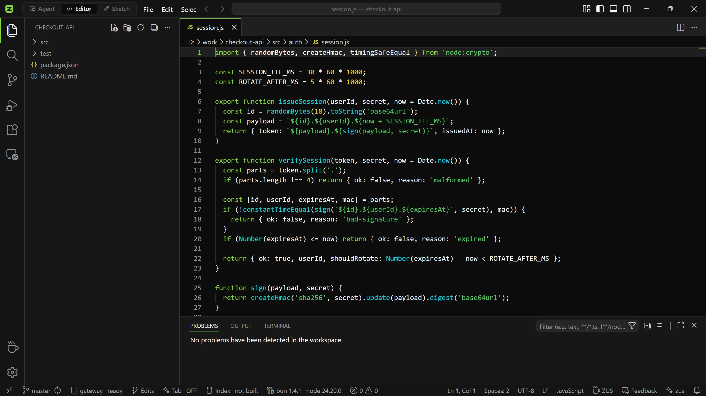
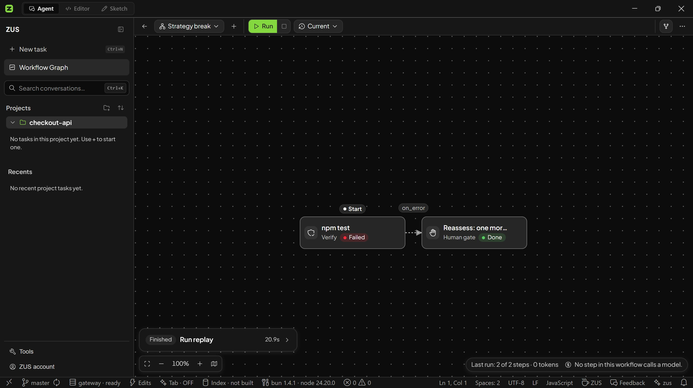
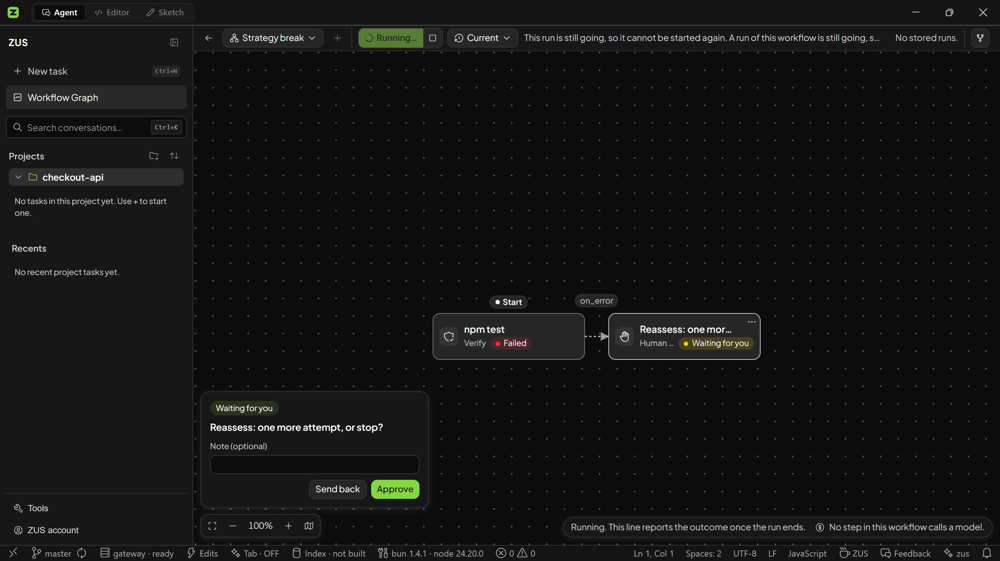
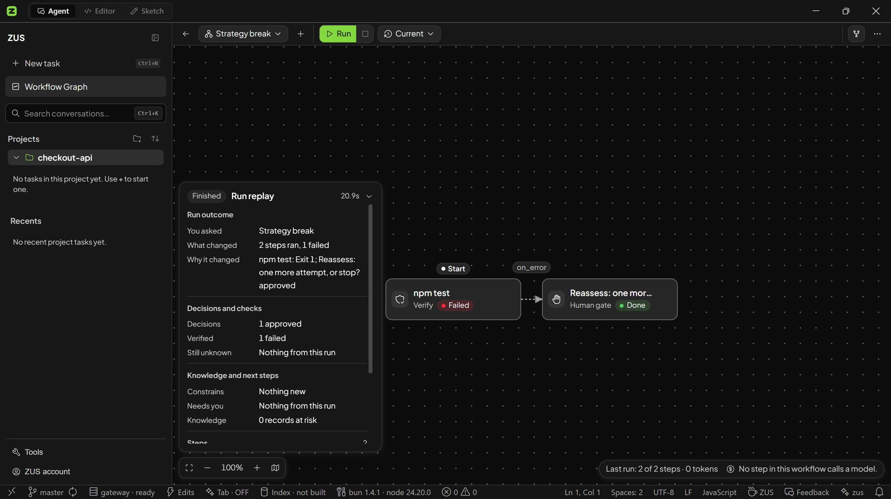
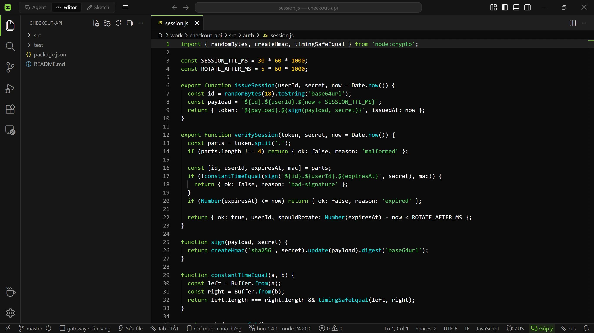
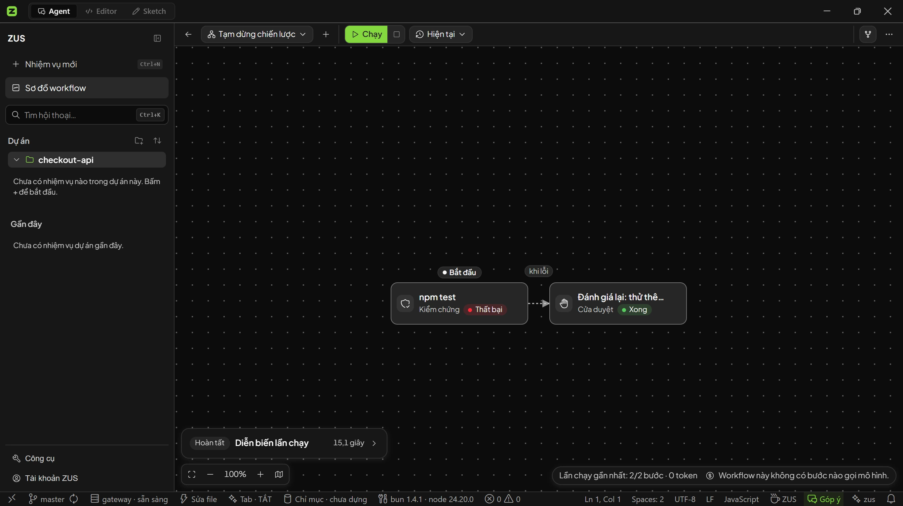
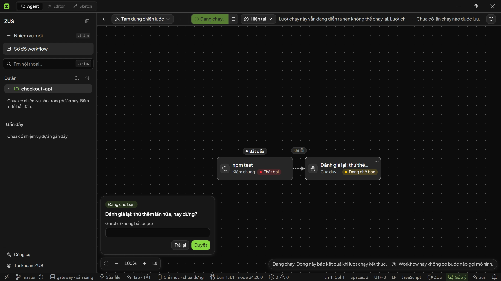

<div align="center">


# ZUS

**A lightweight AI IDE whose agent proves its work with real exit codes.**

*IDE AI gọn nhẹ, agent chứng minh kết quả bằng exit code thật.*

[](https://github.com/8-Sync-Dev/zus-releases/releases/latest)
[](https://github.com/8-Sync-Dev/zus-releases/releases)
[](https://discord.gg/nj3D2zWSxt)


[English](#english) · [Tiếng Việt](#tiếng-việt) · [Download / Tải về](https://github.com/8-Sync-Dev/zus-releases/releases/latest) · [Discord](https://discord.gg/nj3D2zWSxt)

<br>



<br><br>

**Latest / Bản mới nhất: v1.8.0** (November 19, 2026 · 19/11/2026)

ZUS 1.8.0 runs only on AI providers you connect yourself. Sign in with ChatGPT/Codex or OpenRouter, or add an API key, before you start.<br>
*ZUS 1.8.0 chỉ dùng AI provider do bạn tự kết nối. Hãy đăng nhập ChatGPT/Codex, OpenRouter hoặc thêm API key trước khi bắt đầu.*

</div>

### Release metrics

| Metric / Chỉ số | Value / Giá trị | Notes / Ghi chú |
|---|---|---|
| Releases / Bản phát hành | 16 | v1.1.0 to v1.8.0, July 15 to November 19, 2026. Every release ships Minisign `.sig` files and `SHA256SUMS.txt` |
| App downloads / Lượt tải ứng dụng | 615 | Windows 449, Linux 112, macOS 54. Counts installers plus the update packages the in-app updater fetches. Excludes `.sig`, `latest.json` and `SHA256SUMS.txt`. Includes our own test downloads |
| Files per release / File mỗi bản | 15 | v1.8.0: installers, update packages, `.sig` files, `latest.json`, `SHA256SUMS.txt` |
| Platforms / Hệ điều hành | 3 | Windows x64, macOS Apple Silicon, Linux x64 (deb, rpm, AppImage) |
| Windows installer / Bộ cài Windows | 21.9 MB | `ZUS_1.8.0_x64-setup.exe` is 21,891,362 bytes. Tauri 2 and Rust, no bundled Chromium |

<sub>Updated November 19, 2026. Source: GitHub Releases API (<code>download_count</code> and asset <code>size</code>).</sub>

<sub>Support ZUS / Ủng hộ ZUS: <a href="https://github.com/sponsors/8-Sync-Dev">GitHub Sponsors</a> · <a href="https://zus.8syncdev.com">zus.8syncdev.com</a></sub>

---

## English

ZUS is a desktop IDE for working with an AI agent, built with Tauri 2 and Rust. You get the VS Code workbench (Monaco, terminal, Git, extensions) and an agent that runs your tests and builds in a real terminal. A step turns green only when the process exits with code 0.

Three design choices set it apart from most AI editors:

1. It uses your operating system's WebView with a Rust core instead of shipping its own Chromium, so the Windows installer is 21.9 MB.
2. Code search indexes and embeddings are built and stored on your machine.
3. Agent work runs as a graph of steps with exit codes, Git checkpoints and approval gates you control.

### What's new in 1.8.0

- **Bring your own provider.** ZUS now uses only the providers you connect. The models that used to come with ZUS are no longer offered or metered. Sign in to ChatGPT/Codex or OpenRouter, or add API keys under Models. One provider can hold several keys.
- The agent works on your provider: it reads, searches, edits, runs commands and uses Git in your workspace. It shows the model's reasoning and passes attached images to models that can read them.
- Tab and inline completion run on a model you pick from your providers.
- Agent Rules and Personalization: write guidance in `.zus/rules/*.md` or a personal rule, plus working preferences that you approve.
- Workflow Graph imports n8n workflows and can edit a workflow with AI. You review the change before it applies.
- Memory shows lessons from every workspace. You can pin, unpin or forget them from the chat panel.
- Run your own Discord or Slack bot from your computer, using outbound connections only. Its replies to Ask are read-only, and the Ask switch starts off.
- Worktrees: list them, sync with your local checkout, copy `.worktreeinclude` files and clean up.
- A new workbench layout, a redesigned Agent rail, a first-run welcome and a Guide tab.

Security in 1.8.0: files that hold secrets (`.env`, keys, credentials) stay out of what the model reads, extension secrets stay on the host, and below Autopilot the agent's browser asks before it opens a new site or searches the web.

After you update, press **Refresh models** once on each connected provider.

Recent releases also added conversation compaction with Undo and voice dictation with Vietnamese first (1.7.6), and plan task rows, web citations and a live view of the agent's browser (1.7.8). Full notes: [releases](https://github.com/8-Sync-Dev/zus-releases/releases).

### Install

#### Windows

Download `ZUS_x.y.z_x64-setup.exe` from the [latest release](https://github.com/8-Sync-Dev/zus-releases/releases/latest) and run it.

Or use Scoop:

```powershell
scoop bucket add zus https://github.com/8-Sync-Dev/scoop-zus
scoop install zus
```

The Scoop bucket lags behind releases: as of November 19, 2026 it installs 1.7.6. For 1.8.0, use the direct download.

As of November 19, 2026, winget is not available. The package `8syncdev.ZUS` was removed from the winget catalog, and its return with 1.8.0 is [in review](https://github.com/microsoft/winget-pkgs/pull/483890).

> **SmartScreen:** the direct installer is not signed with a Windows code-signing certificate yet, so Windows may warn you. Check the Minisign signature (see below), then click **More info** and **Run anyway**. Installing through Scoop avoids the prompt.

#### macOS (Apple Silicon)

Download `ZUS_x.y.z_aarch64.dmg`. On first launch, right-click the app and choose **Open**, then **Open** again. Or run:

```bash
xattr -dr com.apple.quarantine /Applications/ZUS.app
```

#### Linux

| Distribution | Command |
|---|---|
| Debian / Ubuntu | `sudo apt install ./ZUS_x.y.z_amd64.deb` |
| Fedora / RHEL | `sudo dnf install ./ZUS-x.y.z-1.x86_64.rpm` |
| Any | `chmod +x ZUS_x.y.z_amd64.AppImage && ./ZUS_x.y.z_amd64.AppImage` |

### First run

1. Open **Models** and connect a provider: sign in to ChatGPT/Codex or OpenRouter, or paste an API key.
2. Open a project folder.
3. Choose how much the agent may do on its own, then describe the task in the Agent panel.

### What ZUS does

#### Light on your machine

- The Windows installer is 21.9 MB, compared with about 184 MB for Cursor and 199 MB for VS Code.
- The app starts in under 400 ms on modern hardware and stays under 120 MB of memory when idle, leaving room for your builds and tests.

#### Three ways to run the agent

- **Chat with Live Plan** (`zus://agent`): talk to the agent while a task list shows each step as pending, running, done or blocked.
- **Workflow Graph** (`zus://workflow`): design and run multi-step pipelines (investigate, fix, verify, gate, review) on a canvas. It detects loops and traces error branches.
- **Goals** (`zus://goal`): the agent works across many files in rounds and checks the result after each round.

#### Results you can check

- Test, build and lint steps run in a real terminal. A step shows green only when the process exits with code 0.
- Every tool call and check gets an ID (`step-N-exec-M`) that records the process ID, start and end times, working folder and exit code.
- A failed step has a button that copies the raw terminal output.

#### You stay in control

- Three autonomy levels: **Ask first** (confirm everything), **Edits** (edits files on its own, asks before deletes and commands) and **Autopilot** (runs unattended inside the workspace).
- **Human Gate** stops before deletes, shell scripts and Git commits. Approve, reject, or send the step back with a note.
- When a command fails and its side effects are unknown (`effectUnknown`), the agent stops instead of retrying blindly.
- ZUS takes a Git checkpoint before changing files. Rollback checks your working tree first and will not overwrite edits you made later.

#### Local index, visible traffic

- Embeddings and the code graph index are stored on your disk. Source files are not sent to an outside vector database.
- The **network ledger** (`zus://network-ledger`) records every outbound request from the IDE: host, bytes and which part of ZUS sent it. Export it as CSV or JSON.
- The **context inspector** shows exactly what each turn sends to the model: prompts, attachments and token counts.
- A per-session token cap stops the run as soon as it is reached.
- File writes stay inside the project folder, with an allowlist of paths per command.

#### A familiar workbench

- Review unified or side-by-side diffs for every changed file before you accept.
- Point the agent at `@file`, `@folder`, `@symbol` or `#git` to keep context small.
- Reads project rules from `.cursorrules`, `CLAUDE.md` and `.zus/rules`.
- Connects tools, databases and APIs through the Model Context Protocol (`mcp.json`).
- Monaco editor, PTY terminal, Git graph, project search, Open VSX extensions and 14 themes.

<div align="center">

</div>

<br>

<div align="center">
 
</div>

### Verify your download

Every release includes **Minisign** signatures (`.sig`) made with the ZUS updater key `1c2f579d3d50beda`. The app checks updates against its built-in public key and rejects any file that does not match.

Check a download against `SHA256SUMS.txt`:

```bash
# Verify checksums:
sha256sum -c --ignore-missing SHA256SUMS.txt

# Verify SHA256SUMS.txt authenticity via minisign:
minisign -Vm SHA256SUMS.txt -x SHA256SUMS.txt.sig \
  -P RWQcL1edPVC+2lpQSHFmsRXjz8wl4PI2PNpttRs7zZ7lqAvtNZU18tho
```

To check one file by its own signature (for example `ZUS_x.y.z_amd64.AppImage`):

```bash
base64 -d ZUS_x.y.z_amd64.AppImage.sig > artifact.minisig
minisign -Vm ZUS_x.y.z_amd64.AppImage -x artifact.minisig \
  -P RWQcL1edPVC+2lpQSHFmsRXjz8wl4PI2PNpttRs7zZ7lqAvtNZU18tho
```

### Updates

On launch, ZUS reads `latest.json` from the latest release and updates in place. It verifies the signature of every update before installing it.

### Known limits in 1.8.0

- On Windows, the TypeScript server may not answer for files in deeply nested folders.
- If Chromium was installed with Scoop, the agent's browser may start in your saved profile, with your cookies.
- Some dependency security advisories are still being worked through.
- Many changes have not been checked natively on all three systems yet. Details are in the [release notes](https://github.com/8-Sync-Dev/zus-releases/releases/latest).

### Community

Ask questions, share workflows and report bugs on the ZUS Discord: **[discord.gg/nj3D2zWSxt](https://discord.gg/nj3D2zWSxt)**.

---

## Tiếng Việt

ZUS là IDE desktop để làm việc cùng AI agent, viết bằng Tauri 2 và Rust. Bạn có workbench quen thuộc của VS Code (Monaco, terminal, Git, extension) và một agent chạy test, build trong terminal thật. Một bước chỉ chuyển xanh khi process trả về exit code 0.

Ba lựa chọn thiết kế khiến ZUS khác phần lớn các editor AI:

1. Dùng WebView của hệ điều hành cùng lõi Rust, không đóng gói Chromium riêng, nên bộ cài Windows chỉ 21.9 MB.
2. Index tìm kiếm code và embedding được tạo và lưu ngay trên máy bạn.
3. Agent làm việc theo đồ thị các bước, có exit code, Git checkpoint và cửa duyệt do bạn quyết định.

### Có gì mới trong 1.8.0

- **Dùng provider của bạn.** Từ bản này ZUS chỉ dùng các provider bạn tự kết nối. Các model đi kèm ZUS trước đây không còn được cung cấp hay đo mức sử dụng. Đăng nhập ChatGPT/Codex hoặc OpenRouter, hoặc thêm API key trong Models. Mỗi provider nhận được nhiều key.
- Agent chạy trên provider của bạn: đọc, tìm, sửa file, chạy lệnh và dùng Git trong workspace. Agent hiển thị phần suy luận của model và gửi ảnh đính kèm cho các model đọc được ảnh.
- Tab completion và inline completion chạy trên model bạn chọn từ provider của mình.
- Agent Rules và Personalization: viết hướng dẫn trong `.zus/rules/*.md` hoặc rule cá nhân, cùng các tuỳ chọn cách làm việc do bạn duyệt.
- Workflow Graph import được workflow n8n và sửa workflow bằng AI. Bạn xem lại thay đổi trước khi áp dụng.
- Memory hiển thị bài học từ mọi workspace. Bạn pin, bỏ pin hoặc xoá chúng ngay trong khung chat.
- Tự chạy bot Discord hoặc Slack trên máy bạn, chỉ dùng kết nối đi ra. Câu trả lời ở chế độ Ask là chỉ đọc, và công tắc Ask mặc định tắt.
- Worktree: xem danh sách, đồng bộ với bản local, chép file `.worktreeinclude` và dọn dẹp.
- Bố cục workbench mới, thanh Agent thiết kế lại, màn hình chào lần đầu và tab Guide.

Bảo mật trong 1.8.0: file chứa secret (`.env`, key, credential) không lọt vào phần model đọc, secret của extension ở lại trên máy host, và khi chưa bật Autopilot, browser của agent hỏi bạn trước khi mở trang mới hoặc tìm kiếm web.

Sau khi cập nhật, bấm **Refresh models** một lần trên mỗi provider đã kết nối.

Các bản gần đây còn thêm: gọn hội thoại (compact) có Undo, nhập bằng giọng nói ưu tiên tiếng Việt (1.7.6); danh sách bước của plan, trích dẫn nguồn web và xem trực tiếp browser của agent (1.7.8). Ghi chú đầy đủ: [releases](https://github.com/8-Sync-Dev/zus-releases/releases).

### Cài đặt

#### Windows

Tải `ZUS_x.y.z_x64-setup.exe` từ [bản phát hành mới nhất](https://github.com/8-Sync-Dev/zus-releases/releases/latest) rồi chạy.

Hoặc dùng Scoop:

```powershell
scoop bucket add zus https://github.com/8-Sync-Dev/scoop-zus
scoop install zus
```

Bucket Scoop cập nhật chậm hơn release: tính đến 19/11/2026, Scoop vẫn cài bản 1.7.6. Muốn dùng 1.8.0, hãy tải trực tiếp.

Tính đến 19/11/2026, winget chưa dùng được. Gói `8syncdev.ZUS` đã bị gỡ khỏi danh mục winget, và yêu cầu đưa 1.8.0 trở lại [đang chờ duyệt](https://github.com/microsoft/winget-pkgs/pull/483890).

> **SmartScreen:** bộ cài tải trực tiếp chưa có chứng chỉ code signing của Windows nên Windows có thể cảnh báo. Hãy kiểm tra chữ ký Minisign (xem bên dưới), rồi bấm **More info** và **Run anyway**. Cài qua Scoop sẽ không gặp cảnh báo này.

#### macOS (Apple Silicon)

Tải `ZUS_x.y.z_aarch64.dmg`. Lần đầu mở, click chuột phải vào app, chọn **Open**, rồi chọn **Open** lần nữa. Hoặc chạy:

```bash
xattr -dr com.apple.quarantine /Applications/ZUS.app
```

#### Linux

| Bản phân phối | Lệnh cài đặt |
|---|---|
| Debian / Ubuntu | `sudo apt install ./ZUS_x.y.z_amd64.deb` |
| Fedora / RHEL | `sudo dnf install ./ZUS-x.y.z-1.x86_64.rpm` |
| Bất kỳ | `chmod +x ZUS_x.y.z_amd64.AppImage && ./ZUS_x.y.z_amd64.AppImage` |

### Lần đầu sử dụng

1. Mở **Models** và kết nối một provider: đăng nhập ChatGPT/Codex hoặc OpenRouter, hoặc dán API key.
2. Mở thư mục dự án.
3. Chọn mức tự chủ cho agent, rồi mô tả việc cần làm trong khung Agent.

### ZUS làm được gì

#### Nhẹ cho máy

- Bộ cài Windows 21.9 MB, so với khoảng 184 MB của Cursor và 199 MB của VS Code.
- Mở app dưới 400 ms trên máy đời mới, RAM lúc chờ dưới 120 MB, chừa tài nguyên cho build và test.

#### Ba cách chạy agent

- **Chat với Live Plan** (`zus://agent`): trò chuyện với agent, kèm danh sách việc hiển thị từng bước đang chờ, đang chạy, xong hay bị chặn.
- **Workflow Graph** (`zus://workflow`): thiết kế và chạy pipeline nhiều bước (khảo sát, sửa, kiểm chứng, duyệt, review) trên canvas. Có phát hiện vòng lặp và truy vết nhánh lỗi.
- **Goals** (`zus://goal`): agent làm qua nhiều vòng trên nhiều file, kiểm tra kết quả sau mỗi vòng.

#### Kết quả kiểm chứng được

- Bước test, build, lint chạy trong terminal thật. Bước chỉ xanh khi process trả về exit code 0.
- Mỗi lần gọi tool hoặc kiểm tra đều có ID (`step-N-exec-M`), ghi lại process ID, thời điểm bắt đầu và kết thúc, thư mục làm việc và exit code.
- Bước lỗi có nút chép toàn bộ output terminal.

#### Bạn nắm quyền quyết định

- Ba mức tự chủ: **Ask first** (hỏi mọi thao tác), **Edits** (tự sửa file, hỏi trước khi xoá hoặc chạy lệnh) và **Autopilot** (tự chạy trong phạm vi workspace).
- **Human Gate** dừng lại trước khi xoá file, chạy shell script hoặc commit Git. Bạn duyệt, từ chối, hoặc trả bước đó về kèm ghi chú.
- Khi một lệnh lỗi mà chưa rõ tác động bên ngoài (`effectUnknown`), agent dừng thay vì thử lại mù quáng.
- ZUS tạo Git checkpoint trước khi sửa file. Khi rollback, ZUS kiểm tra working tree trước và không ghi đè phần bạn sửa sau đó.

#### Index tại máy, lưu lượng mạng minh bạch

- Embedding và index đồ thị code nằm trên ổ cứng của bạn. Mã nguồn không bị gửi lên vector database bên ngoài.
- **Network ledger** (`zus://network-ledger`) ghi lại mọi request đi ra từ IDE: host, số byte và phần nào của ZUS gửi. Xuất được CSV hoặc JSON.
- **Context inspector** cho xem chính xác mỗi lượt gửi gì cho model: prompt, file đính kèm và số token.
- Trần token theo từng phiên dừng lần chạy ngay khi chạm mức.
- Mọi thao tác ghi file nằm trong thư mục dự án, kèm allowlist đường dẫn cho từng lệnh.

#### Workbench quen thuộc

- Xem diff dạng unified hoặc song song cho mọi file thay đổi trước khi chấp nhận.
- Chỉ đúng ngữ cảnh cho agent bằng `@file`, `@folder`, `@symbol` hoặc `#git` để tiết kiệm token.
- Đọc quy ước dự án từ `.cursorrules`, `CLAUDE.md` và `.zus/rules`.
- Kết nối tool, database và API qua Model Context Protocol (`mcp.json`).
- Monaco editor, terminal PTY, Git graph, tìm kiếm toàn dự án, extension từ Open VSX và 14 theme.

<div align="center">

</div>

<br>

<div align="center">
 
</div>

### Kiểm tra file tải về

Mỗi bản phát hành có chữ ký **Minisign** (`.sig`) tạo bằng updater key của ZUS: `1c2f579d3d50beda`. App đối chiếu mọi bản cập nhật với public key có sẵn bên trong và từ chối file không khớp.

Kiểm tra file tải về bằng `SHA256SUMS.txt`:

```bash
# Kiểm tra mã băm SHA256:
sha256sum -c --ignore-missing SHA256SUMS.txt

# Xác thực file SHA256SUMS qua minisign:
minisign -Vm SHA256SUMS.txt -x SHA256SUMS.txt.sig \
  -P RWQcL1edPVC+2lpQSHFmsRXjz8wl4PI2PNpttRs7zZ7lqAvtNZU18tho
```

Kiểm tra một file theo chữ ký riêng của nó (ví dụ `ZUS_x.y.z_amd64.AppImage`):

```bash
base64 -d ZUS_x.y.z_amd64.AppImage.sig > artifact.minisig
minisign -Vm ZUS_x.y.z_amd64.AppImage -x artifact.minisig \
  -P RWQcL1edPVC+2lpQSHFmsRXjz8wl4PI2PNpttRs7zZ7lqAvtNZU18tho
```

### Cập nhật

Mỗi lần mở, ZUS đọc `latest.json` của bản phát hành mới nhất và cập nhật tại chỗ. App kiểm tra chữ ký của mọi bản cập nhật trước khi cài.

### Giới hạn đã biết của 1.8.0

- Trên Windows, TypeScript server có thể không phản hồi với file nằm trong thư mục lồng quá sâu.
- Nếu Chromium được cài qua Scoop, browser của agent có thể mở bằng profile đã lưu của bạn, kèm cookie.
- Một số cảnh báo bảo mật của dependency vẫn đang được xử lý.
- Nhiều thay đổi chưa được kiểm tra trực tiếp trên cả ba hệ điều hành. Chi tiết trong [release notes](https://github.com/8-Sync-Dev/zus-releases/releases/latest).

### Cộng đồng

Hỏi đáp, chia sẻ workflow và báo lỗi trên Discord của ZUS: **[discord.gg/nj3D2zWSxt](https://discord.gg/nj3D2zWSxt)**.

---

<div align="center">


**8 Sync** · [8syncdev.com](https://8syncdev.com) · [Discord](https://discord.gg/nj3D2zWSxt) · atus@8syncdev.com

*Sync is a loop: two systems, one link.*

</div>
