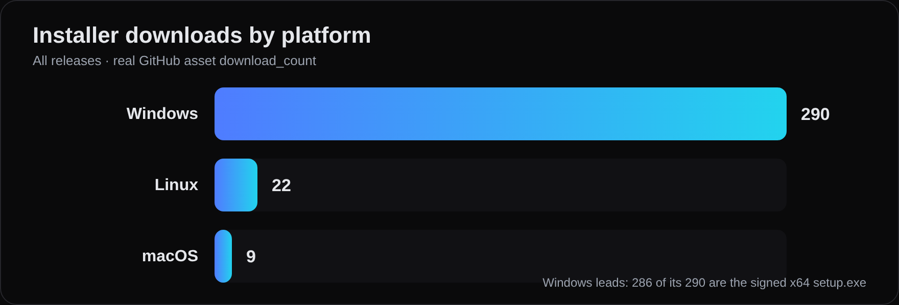
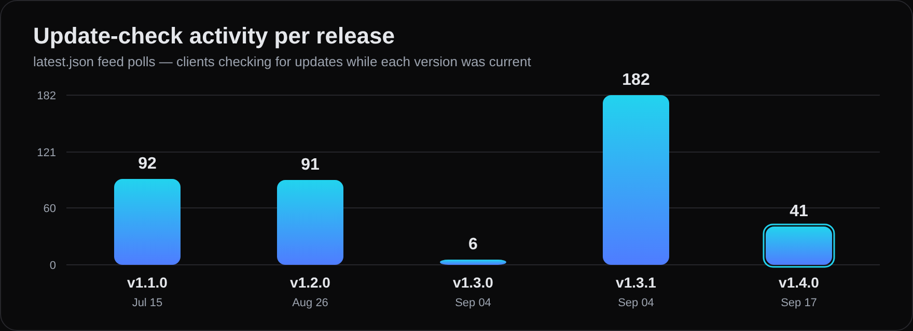

<div align="center">


# ZUS

**The ~22 MB AI-native IDE that proves its work before you merge.**

*Giao việc lớn cho AI mà không sợ nát project.*

[](https://github.com/8syncdev/zus-releases/releases/latest)
[](https://github.com/8syncdev/zus-releases/releases)
[](https://discord.gg/Pparnq7bV7)


[🇬🇧 English](#-english) · [🇻🇳 Tiếng Việt](#-tiếng-việt) · [💬 Discord Community](https://discord.gg/Pparnq7bV7)

<br>


</div>

---

<div align="center">

### 📊 Số liệu thật · By the numbers

<sub>Cập nhật 18/09/2026 · nguồn: <a href="https://docs.github.com/rest/releases">GitHub Releases API</a> (<code>download_count</code>) + Traffic API — số thô, không làm tròn, không tô vẽ. · Real GitHub data, unrounded, unspun.</sub>

</div>

| Chỉ số / Metric | Giá trị / Value | |
|---|---|---|
| Bản phát hành đã ký / Signed releases | **5** | v1.1.0 → v1.4.0 · Jul 15 → Sep 17, 2026 |
| Lượt tải bộ cài / Installer downloads | **321** | Windows 290 · Linux 22 · macOS 9 *(chưa tính `.sig` & feed)* |
| Lượt kiểm tra cập nhật / Update-checks | **412** | `latest.json` feed polls |
| Artifact ký số mỗi bản / Signed artifacts per release | **9** | mọi file kèm minisign `.sig` |
| Hệ điều hành / Operating systems | **3** | Windows x64 · macOS arm64 · Linux (deb·rpm·AppImage) |
| Bộ cài Windows / Windows installer | **~22 MB** | Tauri 2 + Rust, không nhúng Chromium |

<div align="center">





<sub><b>Mới nhất / Latest — v1.4.0 (17/09/2026):</b> workflow "reality-gate" (execution provenance minted · persisted · projected) · composer <code>/</code> command menu + installed skills · đổi tên hội thoại / conversation rename · biên nhận theo lượt / per-turn receipts. Xem <a href="https://github.com/8syncdev/zus-releases/releases/latest">release notes</a>.</sub>

</div>

---

## 🇬🇧 English

You assign a 7-step refactoring task to an AI agent, grab a coffee, and return to your desk:

Did it cleanly resolve the root cause, or did it quietly rewrite half your codebase and leave your Git working tree in flames?
And why does a modern code editor require a 200 MB installer and gigabytes of idle RAM just to open a few source files?

ZUS is built around an uncompromising engineering reality: **Developers should never have to sacrifice workstation performance or codebase control to build with AI.**

Instead of bundling an entire Chromium browser, ZUS pairs your operating system's native WebView with a high-throughput Rust engine. Instead of burying code changes inside endless chat transcripts, ZUS treats every task as a structured execution run: inspect touched files, review diffs, and verify actual operating system exit codes at a glance.

### What Makes ZUS Different

#### 1. Architecture: ~22 MB Installer, Nearly 9x Lighter
- **Native Desktop Engine:** Powered by Tauri 2 and a Rust core utilizing your OS native WebView. No bundled Chromium (Electron) bloat.
- **Instant Cold Boot:** Starts in milliseconds with minimal idle memory consumption, leaving your RAM and CPU cycles for your compilation toolchain.

#### 2. Dual-Lane Agentic Execution
- **Interactive Chat with Live Plan (`zus://agent`):** Chat directly with an agent backed by a real-time Live Plan task list (pending, running, completed, blocked). Task progression updates monotonically as code is written.
- **Visual Workflow DAG Canvas (`zus://workflow`):** Build and run multi-step execution graphs (Investigate, Fix, Verify, Gate, Review) with visual node inspection, error branch tracing, and loop detection.
- **Autonomous Multi-Round Loop (`zus://goal`):** Hands-off goal execution engine that tackles complex multi-file objectives with deterministic pass/fail verification on each round.

#### 3. Deterministic Verification: Real Exit Codes
- **True Exit Codes:** Verification commands (build, test, lint) run in real terminal processes and check real OS exit codes. Passing, failing, and unverified states are strictly isolated. No fake green badges or AI hallucinations.
- **Execution Provenance:** Every tool and verification step mints an immutable provenance ID (`step-N-exec-M`), capturing the exact process ID, timestamps, environment, and exit status.
- **One-Click Error Log Copy:** Instantly copy raw terminal error outputs from failed steps directly into your clipboard.

#### 4. Safety Guardrails & Human Gates
- **Granular Autonomy Levels:** Three distinct operating tiers: Ask first, Edits (auto-edit files with consent for deletions/commands), and Autopilot.
- **Human Gate (Cửa duyệt):** Execution pauses at sensitive checkpoints (file deletions, system commands, commits). Approve, reject, or return with notes injected straight into the execution history.
- **Anti-Blind-Retry Guard:** If an action fails with unknown external side-effects (`effectUnknown`), the engine halts rather than blindly retrying and thrashing your environment.
- **Git Snapshot Checkpoints & Safe Rollback:** Automated Git checkpoints before destructive operations. Fail-closed rollback prevents overwriting changes made after a checkpoint.

#### 5. Local-First Privacy & Complete Transparency
- **On-Device Semantic Index:** Vector embeddings and codebase index remain strictly on your local disk.
- **Network Egress Ledger (`zus://network-ledger`):** Real-time ledger recording every outgoing packet (destination host, request/response bytes, subsystem). Filter and export to CSV or JSON for compliance audits.
- **Context Inspector:** Inspect the exact raw payload, prompt tokens, attached files, and system instructions sent to the model before it fires.
- **Token Cost Circuit Breaker:** Hard session ceilings prevent runaway API quota exhaustion.
- **Native Workspace Jail:** File modifications are strictly jailed within your workspace root with per-command allowlists.

#### 6. Developer Experience & Extensibility
- **Unified Diff Review:** Per-file and bulk diff inspector with visual indicators of additions and deletions before accepting changes.
- **Context Pickers:** Target `@file`, `@folder`, `@symbol`, and `#git` to curate precise context without bloating token windows.
- **Rules Ingestion:** Native support for `.cursorrules`, `CLAUDE.md`, and `.zus/rules`.
- **Model Context Protocol (MCP):** Connect custom tools, local databases, and external APIs using industry-standard `mcp.json` declarations.
- **The Full VS Code Workbench:** Monaco editor, integrated PTY terminal, visual Git graph, project search, Open VSX extensions marketplace, and 14 curated themes.

<div align="center">

</div>

<br>

<div align="center">
 
</div>

### Install

#### Windows

Install via Winget (avoids SmartScreen prompts):

```powershell
winget install 8syncdev.ZUS
```

Or via Scoop:

```powershell
scoop bucket add zus https://github.com/8syncdev/scoop-zus
scoop install zus
```

Or download `ZUS_x.y.z_x64-setup.exe` directly from the [Latest release](https://github.com/8syncdev/zus-releases/releases/latest).

> **SmartScreen note:** Manual installers do not yet carry an enterprise certificate. Installing via **winget or scoop bypasses the warning**. For a manually downloaded `.exe`, verify the minisign signature below, then click **More info → Run anyway**.

#### macOS (Apple Silicon)

Download `ZUS_x.y.z_aarch64.dmg`. On first launch, right-click the app and choose **Open → Open**, or execute:

```bash
xattr -dr com.apple.quarantine /Applications/ZUS.app
```

#### Linux

| Distro | Command |
|---|---|
| Debian / Ubuntu | `sudo apt install ./ZUS_x.y.z_amd64.deb` |
| Fedora / RHEL | `sudo dnf install ./ZUS-x.y.z-1.x86_64.rpm` |
| Any | `chmod +x ZUS_x.y.z_amd64.AppImage && ./ZUS_x.y.z_amd64.AppImage` |

### Verify a download

The trust anchor is the **minisign signature** (`.sig`) shipped next to every release artifact, generated with the ZUS updater key `1c2f579d3d50beda`.
The app verifies these signatures automatically against its compiled-in public key before installing any update: any tampered binary is rejected fail-closed.

Use `SHA256SUMS.txt` to verify download integrity:

```bash
# Verify checksums:
sha256sum -c --ignore-missing SHA256SUMS.txt

# Verify SHA256SUMS.txt authenticity via minisign:
minisign -Vm SHA256SUMS.txt -x SHA256SUMS.txt.sig \
  -P RWQcL1edPVC+2lpQSHFmsRXjz8wl4PI2PNpttRs7zZ7lqAvtNZU18tho
```

To verify an individual artifact manually (such as `ZUS_x.y.z_amd64.AppImage` and its `.sig`):

```bash
base64 -d ZUS_x.y.z_amd64.AppImage.sig > artifact.minisig
minisign -Vm ZUS_x.y.z_amd64.AppImage -x artifact.minisig \
  -P RWQcL1edPVC+2lpQSHFmsRXjz8wl4PI2PNpttRs7zZ7lqAvtNZU18tho
```

### Auto-updates

Install once. On every launch, ZUS queries `latest.json` from the latest release and applies updates in place. **Every update binary is cryptographically verified before installation**. Works seamlessly across all installation channels.

### Community

Have questions, feature suggestions, or looking to share agent workflows?
Join the official ZUS Discord community: **[discord.gg/Pparnq7bV7](https://discord.gg/Pparnq7bV7)**.

---

## 🇻🇳 Tiếng Việt

Bạn giao một task refactor 7 bước cho AI, đi pha cốc cà phê rồi quay lại:

Liệu nó đã giải quyết triệt để lỗi, hay âm thầm viết lại cả dự án khiến Git đỏ lòm?
Và tại sao một công cụ lập trình lại cần bộ cài hơn 200 MB, nuốt chửng hàng gigabyte RAM chỉ để mở vài file nguồn?

ZUS được sinh ra từ một câu hỏi thực tế: **Tại sao lập trình viên phải đánh đổi hiệu năng phần cứng và sự an toàn của mã nguồn chỉ để dùng AI?**

Thay vì nhồi nhét cả một trình duyệt Chromium cồng kềnh vào máy bạn, ZUS chọn kiến trúc desktop native với lõi Rust siêu nhẹ. Thay vì bắt bạn lội qua hàng chục tin nhắn chat để mò xem code đã đổi những gì, ZUS biến mỗi phiên làm việc thành một tiến trình minh bạch: thấy rõ từng file đã sửa, diff trực quan và kết quả kiểm chứng thực tế từ terminal.

### Điểm khác biệt của ZUS

#### 1. Kiến trúc: Bộ cài ~22 MB, nhẹ hơn gần 9 lần
- **Lõi Desktop Native:** Dựng trên Tauri 2 và lõi Rust hiệu năng cao, tận dụng WebView có sẵn của hệ điều hành. Không nhúng Chromium (Electron).
- **Khởi động tức thì:** Mở app chỉ tính bằng mili-giây, trả lại toàn bộ RAM và CPU cho chính dự án của bạn thay vì tiêu tốn cho vỏ bọc IDE.

#### 2. Hai chế độ thực thi Agentic linh hoạt
- **Chat tương tác kèm Kế hoạch thời gian thực (`zus://agent`):** Trò chuyện trực tiếp với agent có tích hợp danh sách Live Plan (đang chờ, đang chạy, hoàn thành, bị chặn). Tiến trình công việc hiển thị đơn luồng rõ ràng ngay khi viết code.
- **Sơ đồ Workflow DAG trực quan (`zus://workflow`):** Xây dựng và thực thi các đồ thị công việc nhiều bước (Khảo sát, Sửa, Kiểm chứng, Cửa duyệt, Rà soát) với bảng thông tin từng node, truy vết nhánh lỗi và tự động phát hiện vòng lặp vô tận.
- **Vòng lặp Autonomous Goal (`zus://goal`):** Engine tự giải quyết bài toán lớn xuyên suốt nhiều file, chạy kiểm chứng pass/fail tự động sau mỗi lượt.

#### 3. Kiểm chứng tất định: Test thật mới báo xanh
- **Bắt mã thoát (Exit Code) thực tế:** Mọi lệnh kiểm chứng (build, test, lint) đều chạy trong terminal thật và nhận exit code chuẩn từ hệ điều hành. Đạt, lỗi hay chưa kiểm tra là ba trạng thái tách biệt hoàn toàn. Không bao giờ tạo tiến độ ảo hay lừa mắt bằng màu xanh giả tạo.
- **Xuất xứ thực thi (Execution Provenance):** Mỗi lần chạy tool hoặc kiểm chứng đều được gắn định danh bất biến (`step-N-exec-M`), ghi nhận chính xác process ID, mốc thời gian, môi trường và trạng thái kết thúc.
- **Copy nhanh log lỗi:** Nút copy trực quan ngay trên hộp log của bước hỏng, sao chép nguyên văn output lỗi vào clipboard chỉ với một click.

#### 4. Vòng kiểm soát an toàn & Cửa duyệt (Human Gate)
- **3 mức tự chủ rõ ràng:** Ask first (hỏi trước mọi thao tác), Edits (tự sửa file, hỏi khi xóa file hoặc chạy lệnh), và Autopilot.
- **Cửa duyệt (Human Gate):** Tiến trình tự động dừng lại trước các thao tác rủi ro (xóa file, chạy lệnh hệ thống, commit). Bạn có thể duyệt tiếp, từ chối, hoặc trả về kèm ghi chú được lưu thẳng vào lịch sử bước.
- **Chặn thử lại mù quáng (Anti-Blind-Retry):** Khi một bước gặp lỗi mà chưa rõ tác động ngoại vi (`effectUnknown`), hệ thống sẽ dừng lại xin ý kiến thay vì cắm đầu chạy lại làm hỏng môi trường.
- **Bản chụp Checkpoint qua Git & Hoàn tác an toàn:** Tự động tạo snapshot Git trước các bước can thiệp sâu. Cơ chế hoàn tác dừng lại cảnh báo nếu phát hiện file bị sửa đổi sau checkpoint, bảo vệ tuyệt đối code bạn vừa gõ.

#### 5. Quyền riêng tư Local-First & Minh bạch tuyệt đối
- **Index ngữ nghĩa lưu hoàn toàn trên máy:** Cơ sở dữ liệu vector và chỉ mục ngữ nghĩa nằm trọn trên ổ cứng của bạn.
- **Sổ cái xuất mạng (`zus://network-ledger`):** Bảng ghi nhận thời gian thực mọi kết nối ra ngoài máy (host đích, byte gửi/nhận, hệ thống con). Lọc và xuất file CSV hoặc JSON để phục vụ kiểm toán an toàn.
- **Thanh tra ngữ cảnh (Context Inspector):** Xem chi tiết payload gửi cho model: system prompt, lịch sử hội thoại, file đính kèm và lượng token tiêu tốn trước mỗi lượt chạy.
- **Bộ ngắt mạch chi phí (Token Budget):** Đặt trần token cho từng phiên. Chạm ngưỡng là dừng, không bao giờ âm thầm tiêu lạm quota.
- **Khoanh vùng thao tác (Workspace Jail):** Thao tác ghi file bị giới hạn nghiêm ngặt trong thư mục dự án với danh sách lệnh cho phép rõ ràng.

#### 6. Trải nghiệm lập trình quen thuộc & Khả năng mở rộng
- **Bảng rà soát Diff hợp nhất:** Xem diff trực quan từng file hoặc hàng loạt trước khi chấp nhận thay đổi.
- **Bộ chọn ngữ cảnh thông minh:** Sử dụng `@file`, `@folder`, `@symbol`, `#git` để nạp đúng dữ liệu cần thiết, tránh phình token thừa thãi.
- **Hỗ trợ Rules chuẩn:** Tự động nhận diện `.cursorrules`, `CLAUDE.md`, và `.zus/rules`.
- **Giao thức MCP (Model Context Protocol):** Cắm thêm tool bên ngoài, kết nối database hay CLI nội bộ qua file `mcp.json` chuẩn công nghiệp.
- **Đầy đủ Workbench VS Code:** Trình soạn thảo Monaco, terminal tích hợp, Git graph, tìm kiếm dự án, cài extension từ Open VSX và 14 theme giao diện tinh chỉnh sẵn.

<div align="center">

</div>

<br>

<div align="center">
 
</div>

### Cài đặt

#### Windows

Cài nhanh qua Winget (không dính cảnh báo SmartScreen):

```powershell
winget install 8syncdev.ZUS
```

Hoặc qua Scoop:

```powershell
scoop bucket add zus https://github.com/8syncdev/scoop-zus
scoop install zus
```

Hoặc tải trực tiếp file `ZUS_x.y.z_x64-setup.exe` từ [Bản phát hành mới nhất](https://github.com/8syncdev/zus-releases/releases/latest).

> **Lưu ý về SmartScreen:** Bản cài tải tay chưa gắn chứng chỉ doanh nghiệp nên Windows sẽ hỏi lại. Cài qua **winget hoặc scoop sẽ bỏ qua bước này**. Nếu tải file `.exe` thủ công, bạn có thể đối chiếu chữ ký minisign bên dưới, sau đó bấm **More info → Run anyway**.

#### macOS (Apple Silicon)

Tải file `ZUS_x.y.z_aarch64.dmg` từ release. Bản phát hành chưa notarize: trong lần đầu mở, click chuột phải vào app chọn **Open → Open**, hoặc chạy lệnh trong terminal:

```bash
xattr -dr com.apple.quarantine /Applications/ZUS.app
```

#### Linux

| Distro | Lệnh cài đặt |
|---|---|
| Debian / Ubuntu | `sudo apt install ./ZUS_x.y.z_amd64.deb` |
| Fedora / RHEL | `sudo dnf install ./ZUS-x.y.z-1.x86_64.rpm` |
| Bất kỳ | `chmod +x ZUS_x.y.z_amd64.AppImage && ./ZUS_x.y.z_amd64.AppImage` |

### Xác thực bản tải về

Mỗi bản phát hành đều đi kèm chữ ký số **minisign** (`.sig`) tạo bởi khóa updater của ZUS: `1c2f579d3d50beda`.
Ứng dụng sẽ tự động đối chiếu chữ ký này với public key tích hợp bên trong trước khi cài đặt hoặc cập nhật: file bị can thiệp sẽ bị từ chối ngay lập tức.

`SHA256SUMS.txt` dùng để kiểm tra độ nguyên vẹn của file tải về:

```bash
# Kiểm tra mã băm SHA256:
sha256sum -c --ignore-missing SHA256SUMS.txt

# Xác thực tính xác thực của file SHA256SUMS qua minisign:
minisign -Vm SHA256SUMS.txt -x SHA256SUMS.txt.sig \
  -P RWQcL1edPVC+2lpQSHFmsRXjz8wl4PI2PNpttRs7zZ7lqAvtNZU18tho
```

Để xác thực thủ công một file cài đặt cụ thể (ví dụ `ZUS_x.y.z_amd64.AppImage` và file `.sig` đi kèm):

```bash
base64 -d ZUS_x.y.z_amd64.AppImage.sig > artifact.minisig
minisign -Vm ZUS_x.y.z_amd64.AppImage -x artifact.minisig \
  -P RWQcL1edPVC+2lpQSHFmsRXjz8wl4PI2PNpttRs7zZ7lqAvtNZU18tho
```

### Tự động cập nhật

Cài đặt một lần duy nhất. Mỗi khi khởi động, ZUS sẽ tự kiểm tra file `latest.json` ở bản release mới nhất và tiến hành cập nhật tại chỗ. **Mọi bản update đều phải vượt qua bước kiểm tra chữ ký số trước khi cài đặt**. Cơ chế này áp dụng đồng nhất cho mọi phương thức cài đặt.

### Tham gia cộng đồng

Bạn có câu hỏi về workflow, muốn góp ý tính năng hoặc báo lỗi trực tiếp tới đội ngũ kỹ sư?
Gia nhập Discord chính thức của ZUS: **[discord.gg/Pparnq7bV7](https://discord.gg/Pparnq7bV7)**.

---

<div align="center">


**8 Sync Dev** · [8syncdev.com](https://8syncdev.com) · [Discord](https://discord.gg/Pparnq7bV7) · atus@8syncdev.com

*Sync is a loop: two systems, one link.*

</div>

