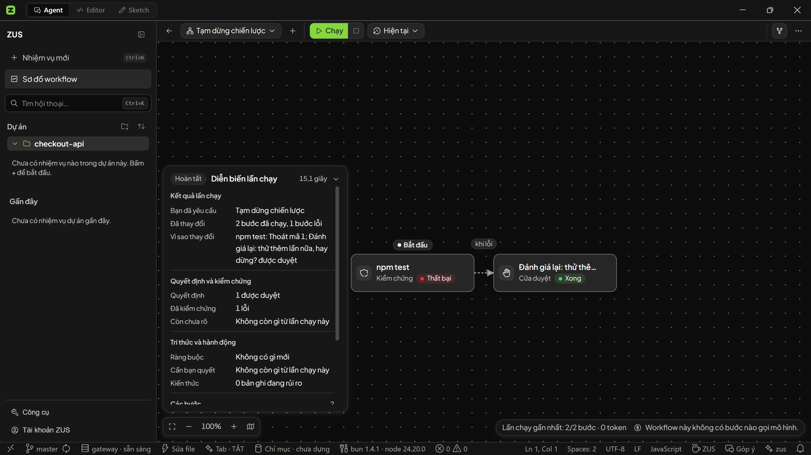

<div align="center">


# ZUS

**Giao việc lớn cho AI mà không sợ nát project.**

*The ~22 MB AI-native IDE that proves its work before you merge.*

[](https://github.com/8syncdev/zus-releases/releases/latest)
[](https://github.com/8syncdev/zus-releases/releases)
[](https://discord.gg/Pparnq7bV7)


[🇻🇳 Tiếng Việt](#-tiếng-việt) · [🇬🇧 English](#-english) · [💬 Tham gia Discord](https://discord.gg/Pparnq7bV7)

<br>


</div>

---

## 🇻🇳 Tiếng Việt

Bạn giao một task refactor 7 bước cho AI, đi pha cốc cà phê rồi quay lại:

Liệu nó đã giải quyết triệt để lỗi, hay âm thầm viết lại cả dự án khiến Git đỏ lòm?
Và tại sao một công cụ lập trình lại cần bộ cài hơn 200 MB, nuốt chửng hàng gigabyte RAM chỉ để mở vài file nguồn?

ZUS được sinh ra từ một câu hỏi thực tế: **Tại sao lập trình viên phải đánh đổi hiệu năng phần cứng và sự an toàn của mã nguồn chỉ để dùng AI?**

Thay vì nhồi nhét cả một trình duyệt Chromium cồng kềnh vào máy bạn, ZUS chọn kiến trúc desktop native với lõi Rust siêu nhẹ. Thay vì bắt bạn lội qua hàng chục tin nhắn chat để mò xem code đã đổi những gì, ZUS biến mỗi phiên làm việc thành một tiến trình minh bạch: thấy rõ từng file đã sửa, diff trực quan và kết quả kiểm chứng thực tế từ terminal.

### Điểm khác biệt của ZUS

- **Bộ cài ~22 MB, nhẹ hơn gần 9 lần:** Kiến trúc Tauri 2 tận dụng WebView có sẵn của hệ điều hành kết hợp lõi Rust hiệu năng cao. Không nhúng Chromium (Electron). Trả lại RAM và CPU cho chính dự án của bạn thay vì tiêu tốn cho vỏ bọc IDE.
- **Dẹp bỏ "hộp đen" trò chuyện:** Lập trình không phải cuộc chat phiếm. ZUS ghi nhận toàn bộ diễn biến thành bản ghi lần chạy (run ledger): thấy rõ file đã chạm vào, diff thay đổi trực quan, không bao giờ để trôi mất ngữ cảnh.
- **Test thật mới báo xanh:** Bước kiểm chứng chạy trực tiếp các lệnh thực tế (build, test, lint) và bắt đúng mã thoát (exit code) từ hệ thống. Đạt, lỗi hay chưa kiểm tra là 3 trạng thái tách biệt. Không bao giờ có màu xanh giả tạo.
- **Mã nguồn và Index nằm trọn trên máy bạn:** Toàn bộ semantic index và vector embeddings được xử lý và lưu trữ cục bộ trên máy của bạn. Thứ duy nhất gửi ra ngoài là prompt và ngữ cảnh tối thiểu cần thiết để gửi cho model.
- **Kiểm soát quyền hạn với Cửa duyệt (Human Gate):** 3 mức tự chủ (Ask first / Edits / Autopilot). Khi chạm tới các thao tác rủi ro như xóa file hay chạy script hệ thống, agent dừng lại chờ bạn duyệt.
- **Trần chi phí an toàn (Token Budget):** Đặt giới hạn token cho từng phiên làm việc. Chạm ngưỡng là dừng, không bao giờ âm thầm tiêu lạm quota.
- **Quen tay tuyệt đối:** Đầy đủ workbench tiêu chuẩn: Monaco editor, terminal tích hợp, Git graph, tìm kiếm dự án, cài extension từ Open VSX và 14 giao diện tinh chỉnh sẵn.
- **Mở rộng linh hoạt với MCP (Model Context Protocol):** Kết nối dễ dàng với database, GitHub hay công cụ nội bộ qua file `mcp.json` theo chuẩn mở công nghiệp.

<div align="center">

</div>

<br>

<div align="center">
 
</div>

### Cài đặt

#### Windows

Cài nhanh qua Winget (không dính cảnh báo SmartScreen):

```powershell
winget install 8syncdev.ZUS
```

Hoặc qua Scoop:

```powershell
scoop bucket add zus https://github.com/8syncdev/scoop-zus
scoop install zus
```

Hoặc tải trực tiếp file `ZUS_x.y.z_x64-setup.exe` từ [Bản phát hành mới nhất](https://github.com/8syncdev/zus-releases/releases/latest).

> **Lưu ý về SmartScreen:** Bản cài tải tay chưa gắn chứng chỉ doanh nghiệp nên Windows sẽ hỏi lại. Cài qua **winget hoặc scoop sẽ bỏ qua bước này**. Nếu tải file `.exe` thủ công, bạn có thể đối chiếu chữ ký minisign bên dưới, sau đó bấm **More info → Run anyway**.

#### macOS (Apple Silicon)

Tải file `ZUS_x.y.z_aarch64.dmg` từ release. Bản phát hành chưa notarize: trong lần đầu mở, click chuột phải vào app chọn **Open → Open**, hoặc chạy lệnh trong terminal:

```bash
xattr -dr com.apple.quarantine /Applications/ZUS.app
```

#### Linux

| Distro | Lệnh cài đặt |
|---|---|
| Debian / Ubuntu | `sudo apt install ./ZUS_x.y.z_amd64.deb` |
| Fedora / RHEL | `sudo dnf install ./ZUS-x.y.z-1.x86_64.rpm` |
| Bất kỳ | `chmod +x ZUS_x.y.z_amd64.AppImage && ./ZUS_x.y.z_amd64.AppImage` |

### Xác thực bản tải về

Mỗi bản phát hành đều đi kèm chữ ký số **minisign** (`.sig`) tạo bởi khóa updater của ZUS: `1c2f579d3d50beda`.
Ứng dụng sẽ tự động đối chiếu chữ ký này với public key tích hợp bên trong trước khi cài đặt hoặc cập nhật: file bị can thiệp sẽ bị từ chối ngay lập tức.

`SHA256SUMS.txt` dùng để kiểm tra độ nguyên vẹn của file tải về:

```bash
# Kiểm tra mã băm SHA256:
sha256sum -c --ignore-missing SHA256SUMS.txt

# Xác thực tính xác thực của file SHA256SUMS qua minisign:
minisign -Vm SHA256SUMS.txt -x SHA256SUMS.txt.sig \
  -P RWQcL1edPVC+2lpQSHFmsRXjz8wl4PI2PNpttRs7zZ7lqAvtNZU18tho
```

Để xác thực thủ công một file cài đặt cụ thể (ví dụ `ZUS_x.y.z_amd64.AppImage` và file `.sig` đi kèm):

```bash
base64 -d ZUS_x.y.z_amd64.AppImage.sig > artifact.minisig
minisign -Vm ZUS_x.y.z_amd64.AppImage -x artifact.minisig \
  -P RWQcL1edPVC+2lpQSHFmsRXjz8wl4PI2PNpttRs7zZ7lqAvtNZU18tho
```

### Tự động cập nhật

Cài đặt một lần duy nhất. Mỗi khi khởi động, ZUS sẽ tự kiểm tra file `latest.json` ở bản release mới nhất và tiến hành cập nhật tại chỗ. **Mọi bản update đều phải vượt qua bước kiểm tra chữ ký số trước khi cài đặt**. Cơ chế này áp dụng đồng nhất cho mọi phương thức cài đặt.

### Tham gia cộng đồng

Bạn có câu hỏi về workflow, muốn góp ý tính năng hoặc báo lỗi trực tiếp tới đội ngũ kỹ sư?
Gia nhập Discord chính thức của ZUS: **[discord.gg/Pparnq7bV7](https://discord.gg/Pparnq7bV7)**.

---

## 🇬🇧 English

You assign a 7-step refactoring task to an AI agent, grab a coffee, and return to your desk:

Did it cleanly resolve the root cause, or did it quietly rewrite half your codebase and wreck your Git working tree?
And why does a modern code editor require a 200 MB installer and gigabytes of idle RAM just to open a few source files?

ZUS was built around an obvious reality: **Developers should never have to sacrifice workstation performance or codebase control just to leverage AI.**

Instead of bundling a resource-heavy Chromium browser, ZUS runs on a desktop-native architecture with a high-throughput Rust core. Instead of burying code modifications inside endless chat transcripts, ZUS treats every task as a structured execution run: inspect touched files, review visual diffs, and verify actual terminal exit codes at a glance.

### Why ZUS Stands Apart

- **~22 MB Installer, Nearly 9x Lighter:** Built with Tauri 2 and Rust, utilizing your operating system's native WebView. No bundled Chromium (Electron) bloat. Instant startup with minimal idle footprint, leaving your RAM and CPU for your actual build tools.
- **No Conversational "Black Box":** Coding is not small talk. ZUS records execution runs into a structured ledger: see modified files, inspect side-by-side diffs, and review changes without losing track of your workflow.
- **Real Exit Codes, Zero Fake Green Badges:** Verification runs actual terminal commands (build, test, lint) and validates real operating system exit codes. Passing, failing, and unverified are strictly separated states. A step never turns green unless your tests actually pass.
- **Local-First Codebase Indexing:** Semantic embeddings and vector indexes remain strictly on your local disk. Only the focused prompt and necessary context leave your workstation.
- **Granular Autonomy with Human Gates:** Three distinct operating levels (Ask first / Edits / Autopilot). Sensitive operations like file deletions or terminal commands pause at a consent checkpoint for your explicit approval.
- **Token Budget Ceilings:** Set explicit token limits per session. The agent halts automatically upon hitting the threshold, preventing runaway quota consumption.
- **The Full Workbench You Already Know:** Zero muscle-memory friction. Monaco editor, integrated terminal, interactive Git graph, project-wide search, Open VSX extensions, and 14 curated themes.
- **Extensible via Model Context Protocol (MCP):** Connect custom tools, local databases, and external APIs using industry-standard `mcp.json` declarations.

<div align="center">

</div>

<br>

<div align="center">
 
</div>

### Install

#### Windows

Install via Winget (avoids SmartScreen prompts):

```powershell
winget install 8syncdev.ZUS
```

Or via Scoop:

```powershell
scoop bucket add zus https://github.com/8syncdev/scoop-zus
scoop install zus
```

Or download `ZUS_x.y.z_x64-setup.exe` directly from the [Latest release](https://github.com/8syncdev/zus-releases/releases/latest).

> **SmartScreen note:** Manual installers do not yet carry an enterprise certificate. Installing via **winget or scoop bypasses the warning**. For a manually downloaded `.exe`, verify the minisign signature below, then click **More info → Run anyway**.

#### macOS (Apple Silicon)

Download `ZUS_x.y.z_aarch64.dmg`. On first launch, right-click the app and choose **Open → Open**, or execute:

```bash
xattr -dr com.apple.quarantine /Applications/ZUS.app
```

#### Linux

| Distro | Command |
|---|---|
| Debian / Ubuntu | `sudo apt install ./ZUS_x.y.z_amd64.deb` |
| Fedora / RHEL | `sudo dnf install ./ZUS-x.y.z-1.x86_64.rpm` |
| Any | `chmod +x ZUS_x.y.z_amd64.AppImage && ./ZUS_x.y.z_amd64.AppImage` |

### Verify a download

The trust anchor is the **minisign signature** (`.sig`) shipped next to every release artifact, generated with the ZUS updater key `1c2f579d3d50beda`.
The app verifies these signatures automatically against its compiled-in public key before installing any update: any tampered binary is rejected fail-closed.

Use `SHA256SUMS.txt` to verify download integrity:

```bash
# Verify checksums:
sha256sum -c --ignore-missing SHA256SUMS.txt

# Verify SHA256SUMS.txt authenticity via minisign:
minisign -Vm SHA256SUMS.txt -x SHA256SUMS.txt.sig \
  -P RWQcL1edPVC+2lpQSHFmsRXjz8wl4PI2PNpttRs7zZ7lqAvtNZU18tho
```

To verify an individual artifact manually (such as `ZUS_x.y.z_amd64.AppImage` and its `.sig`):

```bash
base64 -d ZUS_x.y.z_amd64.AppImage.sig > artifact.minisig
minisign -Vm ZUS_x.y.z_amd64.AppImage -x artifact.minisig \
  -P RWQcL1edPVC+2lpQSHFmsRXjz8wl4PI2PNpttRs7zZ7lqAvtNZU18tho
```

### Auto-updates

Install once. On every launch, ZUS queries `latest.json` from the latest release and applies updates in place. **Every update binary is cryptographically verified before installation**. Works seamlessly across all installation channels.

### Community

Have questions, feature suggestions, or looking to share agent workflows?
Join the official ZUS Discord community: **[discord.gg/Pparnq7bV7](https://discord.gg/Pparnq7bV7)**.

---

<div align="center">


**8 Sync Dev** · [8syncdev.com](https://8syncdev.com) · [Discord](https://discord.gg/Pparnq7bV7) · atus@8syncdev.com

*Sync is a loop: two systems, one link.*

</div>

